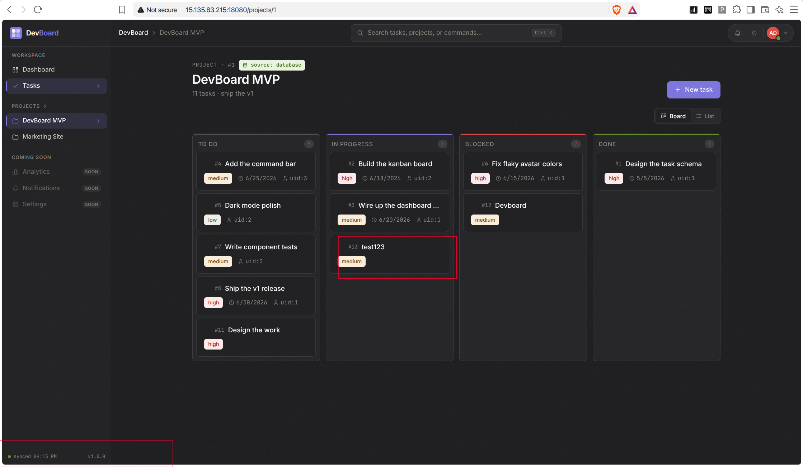
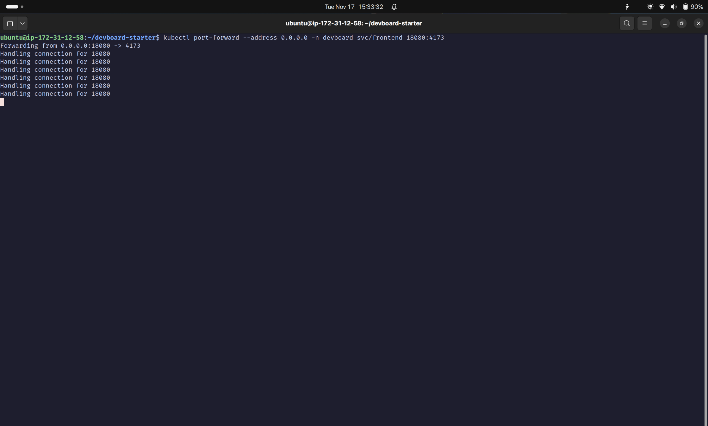
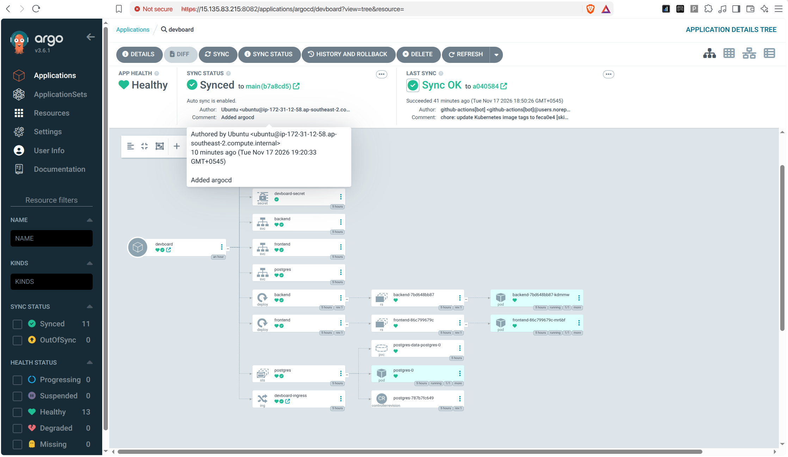
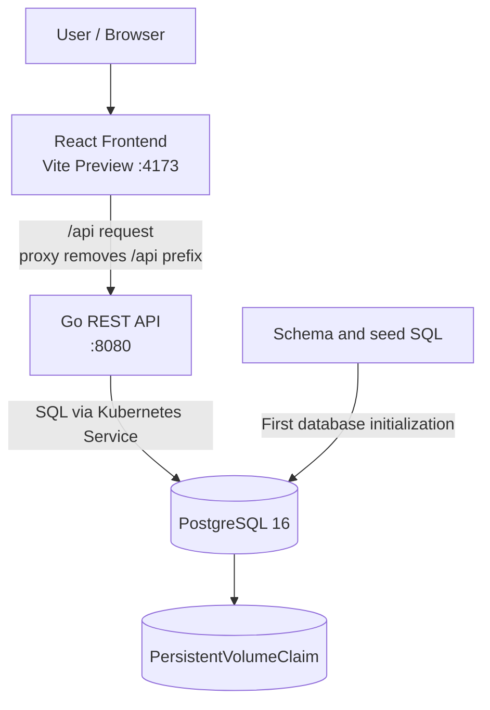
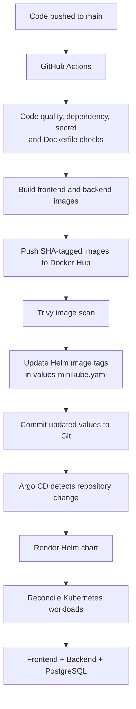

# DevBoard - Advanced (React + Go + PostgreSQL)

DevBoard is a containerized project and task management application built with a React frontend, a Go REST API and PostgreSQL. The repository extends the application into a hands-on cloud-native DevOps project covering Docker, Kubernetes, Helm, GitHub Actions, DevSecOps checks, and Argo CD GitOps.The application uses real persistent database data instead of in-memory mock data.


It demonstrates how application code is packaged into versioned container images, deployed to Kubernetes and continuously reconciled from a Git-managed Helm chart.

## Application Screenshots

### DevBoard application



### Application accessed through Kubernetes port forwarding



### Argo CD application dashboard



## Problem Statement

An application that relies on mock data does not demonstrate the operational requirements of a deployable service. A realistic deployment needs persistent storage, service-to-service communication, repeatable container builds, runtime configuration, health checks, image versioning, and a controlled release process.

DevBoard connects a React user interface to a Go API and PostgreSQL database, then packages and deploys these services with Docker and Kubernetes. GitHub Actions automates build and validation tasks, while Argo CD uses the Helm chart stored in Git as the desired deployment state.

## Architecture

### Application runtime



The frontend serves the compiled React application and proxies `/api/*` requests to the backend. The Go API reads and writes project and task records in PostgreSQL. In Kubernetes, Services provide internal connectivity and the PostgreSQL StatefulSet uses persistent storage.

### CI/CD and GitOps delivery



The configured Argo CD Application tracks the `main` branch at `helm/devboard` and loads `values-minikube.yaml`. Raw manifests under `k8s/` are retained for Kubernetes practice and manual deployment; they are not the configured Argo CD source.

## Technology Stack

| Area | Technologies |
|---|---|
| Frontend | React 18, JavaScript, Vite, React Router, TanStack Query |
| Backend | Go, Gin HTTP framework, REST API |
| Database | PostgreSQL 16, SQL schema and seed scripts |
| Containers | Docker, Docker Compose, Docker Hardened Images |
| Orchestration | Kubernetes, Deployments, Services, StatefulSet, ConfigMaps, Secrets, Ingress, PersistentVolumeClaims |
| Packaging | Helm chart and environment-specific values |
| GitOps | Argo CD Application, automated sync and self-healing |
| CI/CD | GitHub Actions, reusable workflows, Docker Buildx, Docker Hub |
| Security and quality tooling | Gitleaks, govulncheck, npm audit, gosec, Semgrep, Hadolint, Trivy |
| Validation | Helm lint and template rendering, Go tests, Vitest component tests |

## Application Components

### React frontend

- React single-page application built with Vite.
- Dashboard and project views for managing project and task information.
- Task board with status-based columns and task updates.
- React Router for client-side navigation.
- TanStack Query for API data fetching and mutations.
- Vite Preview serves the compiled frontend on port `4173`.
- The preview configuration proxies `/api` requests to the Go backend and removes the `/api` prefix before forwarding.

### Go backend

- REST API implemented with Go and Gin.
- PostgreSQL connectivity through `database/sql` and the PostgreSQL driver.
- Project and task read/write operations.
- Parameterized SQL queries for database operations.
- Startup database connection check and an HTTP health endpoint.
- Configurable listening port through the `PORT` environment variable.

### PostgreSQL database

- PostgreSQL 16 Alpine image.
- Relational schema for `projects` and `tasks`.
- Foreign-key relationship from tasks to projects.
- Status and priority constraints, indexes, and an `updated_at` trigger.
- Initialization SQL in `init/postgres/` for Docker Compose and `helm/devboard/files/` for Helm.
- Docker Compose uses the named `pgdata` volume; Kubernetes uses a StatefulSet with a PersistentVolumeClaim.

## API Reference

The browser calls the API through the frontend's `/api` proxy. The backend serves these routes at the root path.

| Method | Endpoint | Purpose |
|---|---|---|
| GET | `/health` | Backend health response |
| GET | `/projects` | Retrieve projects |
| POST | `/projects` | Create a project |
| GET | `/tasks?project_id={id}` | List tasks for a project |
| POST | `/tasks` | Create a task |
| PATCH | `/tasks/{id}` | Update supported task fields |
| GET | `/search?q={query}&project_id={id}` | Search task titles within a project |

The current application is intentionally a learning project and does not implement user authentication or authorization.

## Run Locally with Docker Compose

### Prerequisites

- Git
- Docker Engine
- Docker Compose plugin

Node.js, Go, and PostgreSQL are not required on the host when using Docker Compose.

### 1. Clone the repository

```bash
git clone https://github.com/Ashish-6-24/devboard-starter.git
cd devboard-starter
```

### 2. Create the local environment file

Docker Compose reads configuration from a root-level `.env` file. Create one with values suitable for local development:

```dotenv
POSTGRES_USER=devboard
POSTGRES_PASSWORD=change-this-local-password
POSTGRES_DB=devboard
POSTGRES_HOST_PORT=5432
BACKEND_PORT=8080
BACKEND_HOST_PORT=8081
FRONTEND_HOST_PORT=8080
IMAGE_TAG=latest
```

Save this as `.env` in the repository root. Local environment files are excluded by `.gitignore`. Do not commit real credentials.

### 3. Build and start the stack

```bash
docker compose up --build -d
```

Check container status and logs:

```bash
docker compose ps
docker compose logs -f
```

### 4. Open the application

| Component | Local address | Description |
|---|---|---|
| Frontend | http://localhost:8080 | DevBoard user interface |
| Backend | http://localhost:8081/health | Go API health endpoint |
| PostgreSQL | localhost:5432 | Database port for local development and diagnostics |

The frontend reaches the API through the internal Compose service name `backend`. The backend reaches PostgreSQL through the Compose service name `postgres`.

### 5. Stop the stack

```bash
docker compose down
```

The named PostgreSQL volume is retained. To remove the database volume and its data as well, use the destructive reset command:

```bash
docker compose down -v
```

The initialization SQL scripts run when PostgreSQL initializes an empty data directory; they do not automatically reseed an existing database volume.

## Test and Validate

### Backend tests

```bash
cd backend
go test ./...
```

### Frontend tests and build

```bash
cd frontend
npm ci --legacy-peer-deps
npm test
npm run lint
npm run build
```

### Helm chart validation

Run these commands from the repository root:

```bash
helm lint ./helm/devboard

helm template devboard ./helm/devboard \
  --namespace devboard-helm \
  --values ./helm/devboard/values-minikube.yaml
```

These commands validate the chart and render Kubernetes resources locally without applying them to a cluster.

## Kubernetes and Helm Deployment

The repository contains two Kubernetes deployment representations:

- `k8s/` — raw Kubernetes YAML manifests retained for direct Kubernetes practice and manual deployment.
- `helm/devboard/` — the Helm chart used by the configured Argo CD Application.

The Helm chart templates the frontend Deployment and Service, backend Deployment and Service, PostgreSQL StatefulSet and headless Service, ConfigMap, database initialization ConfigMap, and Ingress. PostgreSQL storage is requested through a StatefulSet volume claim template.

### Argo CD configuration

The Application manifest is located at `argocd/application.yaml`.

| Setting | Configured value |
|---|---|
| Repository | `https://github.com/Ashish-6-24/devboard-starter.git` |
| Revision | `main` |
| Chart path | `helm/devboard` |
| Helm values file | `values-minikube.yaml` |
| Destination | In-cluster Kubernetes API |
| Namespace | `devboard-helm` |
| Automated sync | Enabled |
| Self-healing | Enabled |
| Pruning | Disabled |

The target namespace is intentionally separate from the raw-manifest namespace `devboard`. Keep the existing raw deployment and its PostgreSQL PVC separate while operating the Helm-managed deployment.

### Provision the PostgreSQL Secret

The Helm chart references an existing Kubernetes Secret named `secret-devboard`, with the key `POSTGRES_PASSWORD`. Create this Secret in `devboard-helm` using a secure password file or an approved secret-management system before syncing the Application.

Example using a password file stored outside the repository:

```bash
kubectl create namespace devboard-helm

kubectl create secret generic secret-devboard \
  --namespace devboard-helm \
  --from-file=POSTGRES_PASSWORD=/secure/path/postgres-password.txt
```

Do not commit the password file or a plaintext Kubernetes Secret to Git. If the Secret already exists, verify that its password matches the password configured in the PostgreSQL database.

### Apply the Argo CD Application

After Argo CD is installed and the Secret is available:

```bash
kubectl apply -f argocd/application.yaml
kubectl get application devboard -n argocd
```

Inspect workloads and persistent storage:

```bash
kubectl get pods,services,statefulsets,pvc -n devboard-helm
kubectl get ingress -n devboard-helm
```

### Access the application with port forwarding

```bash
kubectl port-forward -n devboard-helm svc/frontend 4173:4173
```

Open http://localhost:4173 while the port-forward process is running.

### Access the Argo CD dashboard

```bash
kubectl port-forward svc/argocd-server -n argocd 8081:443
```

Open https://localhost:8081. The initial admin password can be retrieved from the `argocd-initial-admin-secret` in the `argocd` namespace if that bootstrap Secret is still present.

## GitHub Actions CI/CD

Reusable workflows are stored in `.github/workflows/`. The DevSecOps pipeline supports pushes to `main`, pull requests targeting `main`, and manual execution.

The configured workflow set includes:

1. Go and frontend code-quality checks.
2. Go and npm dependency vulnerability checks.
3. Gitleaks secret scanning.
4. Hadolint Dockerfile linting.
5. Helm chart linting and template rendering.
6. Docker Buildx builds for frontend and backend images.
7. Publishing versioned images to Docker Hub.
8. Trivy scans of the built container images.
9. Updating frontend and backend image tags in `helm/devboard/values-minikube.yaml`.
10. Committing the updated Helm values to Git so Argo CD can reconcile the new desired state.

Docker Hub credentials are supplied through GitHub Actions secrets. The image-update workflow uses the image tag produced by the build workflow rather than editing the raw `k8s/` Deployment files.

Some quality and security steps are configured as non-blocking. Review and tighten the failure policy before treating this pipeline as a production release gate.

## Repository Structure

```text
.
├── .github/
│   └── workflows/              # CI, build, scan and image-update workflows
├── argocd/
│   └── application.yaml        # Argo CD Application definition
├── backend/                   # Go REST API, tests and Dockerfile
├── frontend/                  # React/Vite app, tests and Dockerfile
├── helm/
│   └── devboard/              # Helm chart and environment values
├── k8s/                       # Raw Kubernetes manifests
├── init/
│   └── postgres/              # PostgreSQL schema and seed SQL
├── 01-devboard-application.png
├── 02-devboard-port-forward.png
├── 03-argo-cd-dashboard.png
├── docker-compose.yml
├── Makefile
└── README.md
```

## Security, Reliability and Operations

- Keep local `.env` files, database passwords, registry credentials, and Kubernetes Secrets out of source control.
- Use immutable image tags so a Git commit identifies the container version deployed to Kubernetes.
- Keep PostgreSQL storage persistent and test backup and restore procedures.
- Do not expose the PostgreSQL Service to the public network.
- Add authentication and authorization before exposing project and task write operations to untrusted users.
- Configure TLS and an appropriate ingress or reverse-proxy boundary for public access.
- Review container vulnerability findings and make required severity thresholds fail the release pipeline.
- Preserve the existing `devboard` namespace and its database PVC when operating the separate Helm-managed `devboard-helm` deployment.

## Future Improvements

- Implement authentication, role-based authorization, and stronger API request validation.
- Separate liveness and readiness endpoints so database availability is reflected in readiness checks.
- Add database migrations and a tested PostgreSQL backup/restore workflow.
- Enforce CI quality and vulnerability thresholds instead of allowing all scan failures.
- Add Kubernetes autoscaling and disruption controls where cluster capacity permits.
- Introduce Prometheus metrics, Grafana dashboards, centralized logs, and actionable alerts.
- Add TLS, external secret management, and environment-specific deployment promotion.
- Add integration and end-to-end tests for the complete frontend, API, and database path.

## Project Scope

DevBoard is an educational, hands-on cloud-native project focused on full-stack containerization, Kubernetes workload management, Helm packaging, CI/CD automation, DevSecOps checks, and Argo CD GitOps. It is not presented as a production-ready SaaS application: authentication, comprehensive observability, production-grade secret lifecycle management, and a tested disaster-recovery process remain future work.
